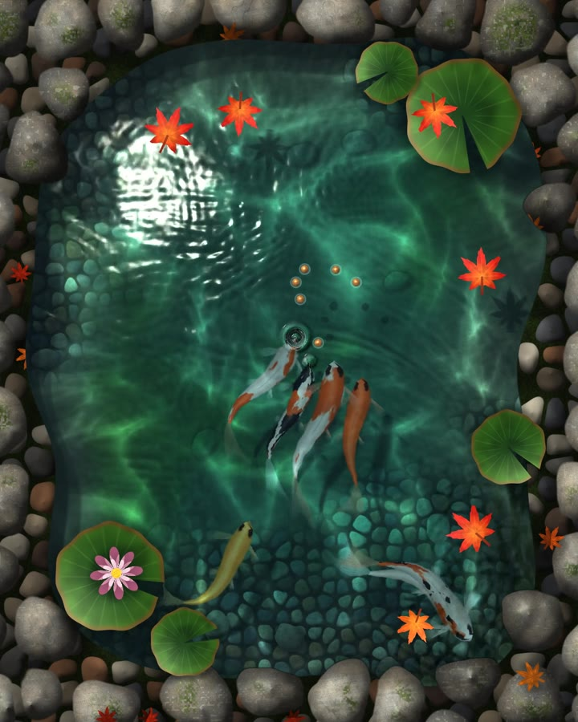

# Koi pond

A koi pond you can touch, in the browser. Tap to drop a handful of food: every pellet lands with a ring, and the koi race
in and gulp it off the surface. Drag your finger through the water and they scatter.

**Live:** https://mys1erious.github.io/sim-koi-pond/

## What you can do
- **Tap**: drop a handful of food. The koi come from anywhere in the pond, and every bite is another ring.
- **Drag**: trail your finger through the water. The koi dart away, and the floating leaves get pushed along.
- **Hover** (desktop): the koi swim over to your hand, expecting food.

## How it works
- **Water**: a height-field wave simulation on the GPU, 120 steps a second. Waves reflect off the stone edge and
  interfere. The surface refracts the floor, throws moving caustics, reflects the sky, and the rings are lit by their
  slope toward the sun, so they read anywhere on the pond.
- **Koi**: seven procedural koi (kohaku, sanke, showa, tancho, ogon, beni) with flexible bodies and fins. They wander,
  avoid each other and the edge, chase the nearest food, and flee a finger in the water.
- **On the surface**: lily pads, autumn maple leaves and food pellets ride the waves; passing rings push them outward.
  Everything casts a shadow on the floor.
- **Stones and floor**: procedural, drawn once per resize.

One HTML file, raw WebGL2, no libraries. It needs a browser with WebGL2.

## URL parameters
| Parameter | Effect |
|---|---|
| `?clean` | hide the text |
| `?play` | replay the scripted demo from `video/keys.json` with a touch cursor |
